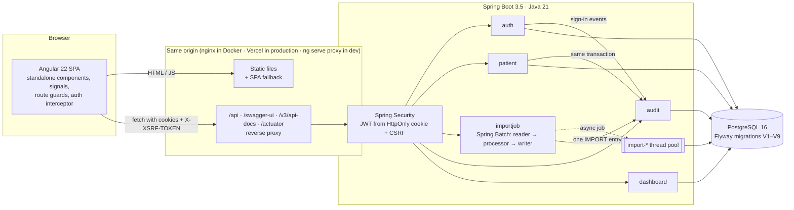

# MediRecords

[](https://github.com/HatKass/medirecords/actions/workflows/ci.yml)


**MediRecords** is a patient records dashboard for a (fictional) clinic. Staff manage patients in a
searchable, paged table, bulk-import messy CSV exports through a Spring Batch pipeline that imports
the good rows and returns a precise, fixable error report for the bad ones, and every change is
recorded in an append-only audit log showing who changed which field from what to what. It is a
full-stack Java 21 / Spring Boot 3 + Angular application with secure cookie-based authentication,
two roles, Flyway-managed PostgreSQL, integration tests against a real database, end-to-end browser
tests and CI, and it runs locally with one command.

> **Live demo:** _coming soon_ <!-- TODO: replace with https://<your-app>.vercel.app -->
> &nbsp;·&nbsp; sign in with `admin` / `demo123` (the first request may take a minute while the free backend wakes up)

<!-- TODO: record a ~20 s GIF (sign in → dashboard → import sample CSV → error report → audit log)
     and save it as docs/media/demo.gif, then replace the placeholder line below with:
      -->
> 🎬 _Demo GIF placeholder: `docs/media/demo.gif`_

---

## Contents

[Features](#features) · [Screenshots](#screenshots) · [Architecture](#architecture) ·
[Tech stack](#tech-stack) · [Run locally](#run-locally-in-one-command) ·
[Demo credentials](#demo-credentials) · [API docs](#api-documentation-swagger) ·
[Sample data](#sample-data) · [Tests](#tests) · [Deployment](#deployment) ·
[Design decisions](#design-decisions) · [Limitations](#limitations)

## Features

**Authentication and roles**
- Sign-in with a short-lived JWT (15 min) in an **HttpOnly, SameSite=Lax cookie**, never readable by JavaScript
- Rotating refresh tokens (7 days), stored hashed, with **replay detection** (a reused token revokes its whole family)
- **CSRF protection** (double-submit cookie, supported natively by Angular)
- Two roles: **ADMIN** (full access) and **VIEWER** (read-only); enforced on the API and reflected in the UI (route guards, hidden actions)
- Session restored on reload; on a `401` the interceptor refreshes once and retries, then sends the user to sign-in and back to the page they wanted

**Patients**
- Paged, sortable table with filters by name (indexed "contains" search), city and blood type
- Create / edit in a side panel, delete with confirmation; client- and server-side validation
- Normalization on save (trimmed names, lower-case emails, canonical phone numbers), unique emails, optimistic locking against lost updates
- Consistent errors as RFC 9457 **ProblemDetail** with per-field messages; DTOs only, entities never leave the service layer

**Bulk CSV import (Spring Batch)**: the showcase feature, see [docs/import-pipeline.md](docs/import-pipeline.md)
- Drag-and-drop upload; the job runs asynchronously and the UI shows **live progress**
- Lenient with real-world exports: any column order, header aliases (`DOB`, `Sex`, `Email Address`…), BOM, CRLF, ten date formats, many gender / blood-type / phone spellings
- Invalid rows are skipped and recorded with **row number and every reason**; duplicates caught within the file and against existing patients
- Import history (status, total / valid / invalid counts, timing) and a downloadable **error report CSV** that can be fixed and re-uploaded as is

**Audit log** (ADMIN only)
- Every create / update / delete with **field-level old → new values**, one entry per import with its counts, and sign-in / failed sign-in / sign-out events
- Written in the same transaction as the change; the table is **append-only** (enforced by a database trigger)
- Filters by user, action and date range, kept in the URL

**Dashboard**
- Summary cards: total patients, imports this week, rejected rows, recent activity
- Patients per blood type chart

**Quality**
- Backend integration tests on a real PostgreSQL 16 (Testcontainers), unit tests, JaCoCo coverage
- Frontend unit tests (Vitest) and Playwright end-to-end tests against the full Docker stack
- GitHub Actions CI on every pull request

## Screenshots

<!-- TODO: add screenshots to docs/media/ (1440×900 recommended) and replace the placeholders below
     with  etc. -->

| | |
|---|---|
| _Dashboard: `docs/media/dashboard.png`_ | _Patients table and edit panel: `docs/media/patients.png`_ |
| _CSV import with live progress: `docs/media/import.png`_ | _Import result and error report: `docs/media/import-result.png`_ |
| _Audit log with field changes: `docs/media/audit-log.png`_ | _Login with demo credentials: `docs/media/login.png`_ |

## Architecture



The backend is **packaged by feature** (`auth`, `patient`, `importjob`, `audit`, `dashboard`, plus
`common`), not by layer. The browser only ever talks to one origin, which is what makes the
HttpOnly cookies and CSRF work without any CORS configuration.

## Tech stack

| Area | Choices |
|---|---|
| Backend | Java 21, Spring Boot 3.5, Spring Web, Spring Data JPA (Hibernate), Spring Security + OAuth2 Resource Server (JWT, HS256), Spring Batch 5, Bean Validation, Flyway, springdoc-openapi 2.8 (Swagger UI), Actuator |
| Database | PostgreSQL 16 (`pg_trgm` for name search, JSONB for audit changes) |
| Frontend | Angular 22 (standalone components, signals, functional guards and interceptors), RxJS, Tailwind CSS 4 |
| Tests | JUnit 5, Mockito, Spring Boot Test, Testcontainers, JaCoCo; Vitest + Angular TestBed; Playwright |
| Infra | Docker (multi-stage builds), Docker Compose, nginx, GitHub Actions |
| Deployment target | Vercel (frontend + `/api` rewrites), Render (backend, Docker), Neon (PostgreSQL) |

## Run locally in one command

Requires only **Docker** (Docker Desktop on Windows/macOS).

```bash
docker compose up --build
```

| Service | URL |
|---|---|
| App | <http://localhost:4200> |
| Swagger UI | <http://localhost:4200/swagger-ui/index.html> (also on :8080) |
| Backend health | <http://localhost:8080/actuator/health> |
| PostgreSQL | `localhost:5433`, database / user / password `medirecords` |

The first build downloads dependencies and takes a few minutes; later starts take seconds. Flyway
creates the schema and seeds two users and ~200 patients. All settings have defaults; to change
ports or secrets copy [`.env.example`](.env.example) to `.env`. Stop with `docker compose down`
(add `-v` to delete the data).

<details>
<summary>Run without Docker (for development)</summary>

```bash
docker compose up -d postgres        # or any PostgreSQL 16 on localhost:5433
cd backend && ./mvnw spring-boot:run # Windows: mvnw.cmd spring-boot:run
cd frontend && npm ci && npx ng serve # http://localhost:4200, proxies /api to :8080
```

JDK 21 and Node 24 are needed. The backend reads every setting from environment variables with
defaults in [`application.yml`](backend/src/main/resources/application.yml).
</details>

## Demo credentials

| Username | Password | Role | Can |
|---|---|---|---|
| `admin` | `demo123` | ADMIN | everything: patients, imports, audit log |
| `viewer` | `demo123` | VIEWER | read patients, dashboard and import history |

They are also shown on the login page. They are demo accounts seeded by a migration; see
[Limitations](#limitations).

## API documentation (Swagger)

- Local: <http://localhost:4200/swagger-ui/index.html> · OpenAPI JSON: `/v3/api-docs`
- Live: _coming soon_ <!-- TODO: https://<your-app>.vercel.app/swagger-ui/index.html -->

Call `POST /api/auth/login` with `{"username": "admin", "password": "demo123"}` first; the browser
then stores the session cookie and Swagger UI sends it, and the CSRF header, on every call.

| Area | Endpoints |
|---|---|
| Auth | `POST /api/auth/login`, `/refresh`, `/logout`; `GET /api/auth/me` |
| Patients | `GET/POST /api/patients`, `GET/PUT/DELETE /api/patients/{id}`, `GET /api/patients/cities` |
| Imports | `POST/GET /api/imports`, `GET /api/imports/{id}`, `/{id}/errors`, `/{id}/errors.csv` |
| Audit | `GET /api/audit-log`, `GET /api/audit-log/actors` (ADMIN) |
| Dashboard | `GET /api/dashboard` |

Reads are open to both roles; every write, and the audit log, requires ADMIN.

## Sample data

[`sample-data/patients_messy.csv`](sample-data/patients_messy.csv): 5,000 fictional patients
exported the way real systems export them (BOM, CRLF, friendly headers, mixed formats, stray
whitespace), with **exactly 250 rows (5%) broken on purpose**: bad emails, invalid dates, missing
names, duplicates within the file and of seeded patients, unknown gender / blood type, wrong column
counts. Import it on the **Import** page as `admin`: a fresh database ends with **4,750 imported and
250 rejected**, and the error report lists each rejected row with its reason. A second import
rejects every row as a duplicate. The file is generated deterministically by
[`generate_patients_messy.py`](sample-data/generate_patients_messy.py); all emails use reserved
`example.*` domains and phone numbers come from the UK drama range.

## Tests

```bash
cd backend && ./mvnw verify             # JUnit + Testcontainers (needs Docker) + JaCoCo report
cd frontend && npx ng test --watch=false
```

End-to-end tests with Playwright run against the Docker stack. Full instructions, what each test
class covers, and how CI is organized: **[docs/TESTING.md](docs/TESTING.md)**.

## Deployment

Frontend on **Vercel**, backend on **Render** (free tier, Docker), database on **Neon**. Vercel
rewrites `/api/*` to Render so the browser stays on one origin and the HttpOnly cookies keep
working. Step-by-step notes, environment variables and JVM memory settings for Render's 512 MB:
**[docs/DEPLOYMENT.md](docs/DEPLOYMENT.md)**.

## Design decisions

### Import pipeline: invalid rows are values, not exceptions

The import is one Spring Batch chunk step. The **reader** streams the file (constant memory) and
matches columns by header name and alias. The **processor** converts each row into the same
`PatientRequest` the REST API accepts, validates it with the same Bean Validation rules and
normalizes it with the same mapper, so an imported patient is indistinguishable from one typed in
the UI. It returns `Valid` or `Invalid` instead of throwing: bad rows never cause chunk rollbacks
and row-by-row retries, which is what makes a 5%-broken file as fast as a clean one. The
**writer** handles a chunk of 500 rows in one transaction: one query finds emails that already
exist, one JDBC batch inserts the rest (JPA cannot batch `IDENTITY` inserts), and the rejected rows
and progress counters are written in the same transaction, so the progress the UI polls is exact.
Spring Batch's skip mechanism is kept only for lines that cannot be parsed at all and rows the
database still refuses (a race on the unique email index). The job runs on a small bounded thread
pool, so uploads return `202` at once and a burst of uploads queues instead of exhausting
connections. Details: [docs/import-pipeline.md](docs/import-pipeline.md).

### Audit log: explicit calls in the service, inside the same transaction

I considered JPA entity listeners and an AOP aspect, and chose **explicit calls from the service
layer** (`audit.recordUpdate(…, before, after)`), with every `record…` method requiring the
caller's transaction (`Propagation.MANDATORY`):

- **Atomic:** the audit row commits with the change or not at all. There is no change without its
  entry, and no entry for a change that was rolled back.
- **Meaningful diffs:** the service compares immutable before/after snapshots (Java records) and
  stores only the fields that changed, as JSONB `[{field, oldValue, newValue}]`; a save with no
  edits writes nothing. Entity listeners see managed entities mid-flush, where old values and
  repository calls are awkward and fragile.
- **Bulk-aware:** an import is audited as **one** entry with its counts. A listener or aspect on
  `save` would write 4,750 entries (and the import bypasses JPA anyway for speed).
- **Visible:** reading `PatientService` shows exactly what is audited; nothing happens by magic.

The trade-off is discipline: a new write path must call the audit service, which the integration
tests check. The table is append-only, enforced by a PostgreSQL trigger that rejects `UPDATE` and
`DELETE`; actors and entity ids are deliberately not foreign keys, so the trail outlives deleted
patients and users. Sign-ins use `REQUIRES_NEW`, because a failed sign-in must be recorded even
though its request fails, and they store only the username and time, never a password or token.

### Authentication: JWT in HttpOnly cookies instead of `localStorage`

The spec asked for stateless JWT. Keeping the token in `localStorage` would let any XSS read it, so
the access token travels in an **HttpOnly, Secure, SameSite=Lax cookie** scoped to `/api`, and the
backend stays stateless (it verifies the JWT on each request). Because the browser now sends
credentials automatically, CSRF protection is switched on with the double-submit cookie pattern
Angular supports natively. Spring Security's resource server normally exempts bearer-token requests
from CSRF; that exemption is undone, since our token comes from a cookie. Refresh tokens are
opaque, rotated on every use, stored as SHA-256 hashes, and grouped in families so a replayed token
revokes the whole session.

### Same origin everywhere, no CORS

nginx (Docker), the Angular dev-server proxy and Vercel rewrites all serve the API under the app's
own origin. That keeps cookies first-party and removes a whole class of CORS misconfiguration; the
backend has no CORS configuration at all.

### Other choices

- **Flyway owns the schema** (Hibernate only validates it), including Spring Batch's tables and the seed data.
- **Package by feature**, constructor injection, records for DTOs, no Lombok.
- **ProblemDetail everywhere**, including 401/403 from the security layer, without leaking internals.
- **Indexes match the UI's queries:** a trigram index for "name contains", a unique index on `lower(email)`, composite indexes for the audit filters.
- **Configuration by environment variables** with working defaults, so `docker compose up` needs no setup.

## Limitations

This is a portfolio project, not a production medical system. Known limits, on purpose or for later:

- **Not compliant with health-data regulations.** No HIPAA/GDPR controls (encryption at rest
  managed by the app, data-retention rules, consent, access reviews). All data is fictional; do
  not store real patient data.
- **Demo accounts with public passwords**, seeded by a migration. There is no user management,
  password change or reset, MFA, or account lockout, and no rate limiting on sign-in.
- **Single backend instance.** Import jobs run in-process; on start-up, imports left `QUEUED`/
  `RUNNING` are marked failed, which assumes one instance. Scaling out would need a job owner
  column or a remote job queue.
- **Uploaded files are stored on local disk** until their job finishes. Fine for one container
  (and for Render's ephemeral disk), not for several.
- **Import only adds patients.** There is no update or upsert of existing patients by email, and a
  failed import is re-run by uploading again (already-imported rows are then rejected as duplicates).
- **Day-first dates.** Ambiguous slash dates are read as `31/12/1980` (UK clinic); a US export would
  need a per-import date-format setting.
- **The audit log relies on discipline:** changes made directly in the database bypass it.
- **English only**, no internationalization or time-zone preference (times are stored in UTC and
  shown in the browser's time zone).
- **Free hosting tier:** the live demo backend sleeps when idle, so the first request after a pause
  is slow.

---

Built with AI-assisted development (Claude Code); all code reviewed and tested by me.
