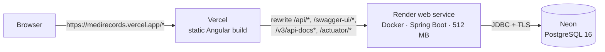

# Deployment

Target setup, all on free tiers: **frontend on Vercel**, **backend on Render (Docker)**,
**PostgreSQL on Neon**.



## Why everything must stay same-origin

The session lives in HttpOnly cookies (`mr_access`, `mr_refresh`) with `SameSite=Lax`, and CSRF
protection relies on the JS-readable `XSRF-TOKEN` cookie. Both only work when the browser sees the
API on **the same origin as the app**. So the browser never calls Render directly: Vercel proxies
`/api/*` to the backend, exactly like nginx does in Docker Compose and `proxy.conf.json` does in
`ng serve`. There is no CORS configuration in the backend, on purpose.

```
browser ──► https://medirecords.vercel.app/            (static Angular build)
        └─► https://medirecords.vercel.app/api/...  ──► Vercel rewrite ──► https://<render-app>.onrender.com/api/...
```

Cookies are set without a `Domain` attribute, so they belong to the Vercel host the browser sees.
Calling the `onrender.com` URL directly from the app would make them third-party cookies, which
browsers block, and sign-in would silently fail.

Deploy in this order: database, backend, frontend (the frontend needs the backend's URL).

## 1. Database (Neon)

1. Create a project with **PostgreSQL 16** in the region closest to your Render region
   (e.g. Frankfurt for both), and a database named `medirecords`.
2. Copy the connection details and turn them into a JDBC URL. Use the **direct** endpoint (host
   without `-pooler`): Flyway migrations and the app's own HikariCP pool work best on a direct
   connection, and the app needs only a handful of connections.

   ```
   DB_URL=jdbc:postgresql://ep-xxxx-xxxx.eu-central-1.aws.neon.tech/medirecords?sslmode=require
   DB_USERNAME=<neon role>
   DB_PASSWORD=<neon password>
   ```

   The JDBC URL holds no credentials; user and password go in their own variables.
3. Nothing else: on first start Flyway creates the schema (V1 enables `pg_trgm`, which Neon
   supports), the Spring Batch tables, the two demo users and ~200 seed patients.

Neon's free compute suspends after a few minutes without connections and resumes on the next
query, which adds a short delay to the first request after a pause. Supabase works the same way
(use its direct connection string, port 5432, with `sslmode=require`).

## 2. Backend (Render, Docker, 512 MB)

Create a **Web Service** from the GitHub repo:

| Setting | Value |
| --- | --- |
| Language / runtime | **Docker** |
| Root directory | `backend` |
| Dockerfile path | `./Dockerfile` (relative to the root directory) |
| Instance type | Free (512 MB RAM, shared CPU) |
| Health check path | `/actuator/health/readiness` |
| Region | same as the Neon database |

Render builds [`backend/Dockerfile`](../backend/Dockerfile) (multi-stage: Maven build on JDK 21,
then a small JRE 21 Alpine image running as a non-root user) and injects `PORT`, which the app
already honours (`server.port: ${PORT:8080}`).

### Environment variables

| Variable | Value | Why |
| --- | --- | --- |
| `DB_URL` | JDBC URL from step 1 | |
| `DB_USERNAME` / `DB_PASSWORD` | Neon credentials | |
| `JWT_SECRET` | random, at least 32 bytes: `openssl rand -base64 48` | the default is a public dev value |
| `COOKIE_SECURE` | `true` (the default) | Vercel serves HTTPS |
| `JAVA_OPTS` | see below | fit the JVM in 512 MB |
| `DB_POOL_SIZE` | `5` | fewer connections, less memory; plenty for a demo |
| `IMPORT_MAX_CONCURRENT_JOBS` | `1` | one import at a time on a small CPU |
| `SERVER_TOMCAT_THREADS_MAX` | `40` | default 200 threads would reserve stack memory needlessly |
| `HEALTH_SHOW_DETAILS` | `never` | don't expose database details on a public URL |
| `JWT_TTL` / `REFRESH_TOKEN_TTL` | optional, defaults `PT15M` / `P7D` | |

Mark `DB_PASSWORD` and `JWT_SECRET` as secret (or put them in a Render environment group).

### JVM memory for a 512 MB instance

The image's default `JAVA_OPTS="-XX:MaxRAMPercentage=75"` gives the heap ~384 MB of the 512 MB
container, leaving too little for everything that lives **outside** the heap (metaspace for
Spring's classes, JIT code cache, thread stacks, GC and network buffers). The container then
exceeds 512 MB and Render kills it (out of memory, restart loop), even though the heap itself is
fine. Override `JAVA_OPTS` on Render with explicit limits:

```
JAVA_OPTS=-Xms128m -Xmx256m -XX:MaxMetaspaceSize=160m -XX:ReservedCodeCacheSize=48m -Xss512k -XX:MaxDirectMemorySize=32m -XX:+UseSerialGC -XX:TieredStopAtLevel=1 -XX:+ExitOnOutOfMemoryError
```

| Flag | Effect |
| --- | --- |
| `-Xms128m -Xmx256m` | heap capped at 256 MB: enough for the app and a 5,000-row import (the reader streams; chunks are 500 rows) |
| `-XX:MaxMetaspaceSize=160m` | caps class metadata (Spring Boot + Hibernate + Batch + springdoc use roughly 110–140 MB) |
| `-XX:ReservedCodeCacheSize=48m` | smaller JIT code cache (default 240 MB reserved) |
| `-Xss512k` | half-size thread stacks |
| `-XX:MaxDirectMemorySize=32m` | caps NIO buffers |
| `-XX:+UseSerialGC` | the lightest collector; right for one small CPU and a small heap |
| `-XX:TieredStopAtLevel=1` | C1 JIT only: faster start-up and less code cache, slightly lower peak speed |
| `-XX:+ExitOnOutOfMemoryError` | exit instead of limping on, so Render restarts the service |

Roughly 256 (heap) + ~140 (metaspace) + 48 (code cache) + ~20 (threads) + 32 (direct) + GC and
JVM overhead stays under 512 MB. Docker Compose is not affected: it keeps the image default.

If the service still restarts, check Render's **Metrics → Memory** graph and lower `-Xmx` to
`224m` before anything else. To try the settings locally, run the backend container with
`--memory=512m` and `-e JAVA_OPTS=...`, import the sample CSV, and watch `docker stats`.

### Free tier behaviour

- The service **spins down after ~15 minutes without traffic**. The next request starts the
  container again; with Spring Boot on a shared CPU that takes up to a minute or two, so the first
  page load of the live demo is slow. Mention this next to the demo link (the README does).
- The disk is **ephemeral**. That is fine: uploaded CSVs are kept only until their job finishes
  (`IMPORT_STORAGE_DIR`, default the system temp dir), and an import cut off by a restart is marked
  failed on the next start.
- Run **one instance**: import jobs run in-process (see the README's Limitations).

Check the service directly once it is live:
`https://<render-app>.onrender.com/actuator/health` should return `{"status":"UP", …}`.

## 3. Frontend (Vercel)

1. **Edit the backend host** in [`frontend/vercel.json`](../frontend/vercel.json): replace the
   placeholder `medirecords-api.onrender.com` (five rewrites) with your Render service host, and
   commit it.
2. In Vercel, import the GitHub repo with **root directory `frontend`**. Leave the framework preset
   as "Other": build settings come from `vercel.json`:
   - `npm ci`, then `ng build --configuration production`, serving `dist/frontend/browser`;
   - **rewrites** `/api/*`, `/swagger-ui/*`, `/v3/api-docs*` and `/actuator/*` to the Render backend;
   - falls back to `index.html` for Angular routes (static files are served first).
3. Set the Node.js version to 24 in the project settings (the same as CI and the Docker build).
4. Deploy. The Angular build needs no API URL: `environment.apiBaseUrl` stays empty (same origin).

Netlify works the same way with a `_redirects` file:
`/api/*  https://<render-app>.onrender.com/api/:splat  200`, followed by `/*  /index.html  200`.

## Checklist after deploying

- `https://<vercel-app>/actuator/health` returns `UP` (proves the rewrite reaches Render).
- Sign in as `admin` / `demo123`, then in DevTools → Application → Cookies, `mr_access` and
  `mr_refresh` are listed under the **Vercel** host with `HttpOnly`, `Secure`, `SameSite=Lax`,
  and `XSRF-TOKEN` is present.
- Create and edit a patient (proves CSRF works through the rewrite: a missing header would be a `403`).
- Import `sample-data/patients_messy.csv`: 4,750 imported, 250 rejected; download the error report.
- Swagger UI: `https://<vercel-app>/swagger-ui/index.html`.
- Update the README's live demo and Swagger links, and add the screenshots and GIF.

## Troubleshooting

| Symptom | Likely cause |
| --- | --- |
| Sign-in succeeds but the next page says "signed out" | the app is calling Render directly instead of through the Vercel rewrite (cookies become third-party and are dropped) |
| `403` on every write | the `XSRF-TOKEN` cookie is missing: check that `/api/*` is rewritten, not redirected (a redirect changes the origin) |
| Render restarts during start-up or an import | container out of memory: apply the `JAVA_OPTS` above, then lower `-Xmx` |
| First request times out | Render (or Neon) was asleep; retry after a minute |
| `FATAL: password authentication failed` / SSL errors | wrong Neon credentials, or `sslmode=require` missing from `DB_URL` |
