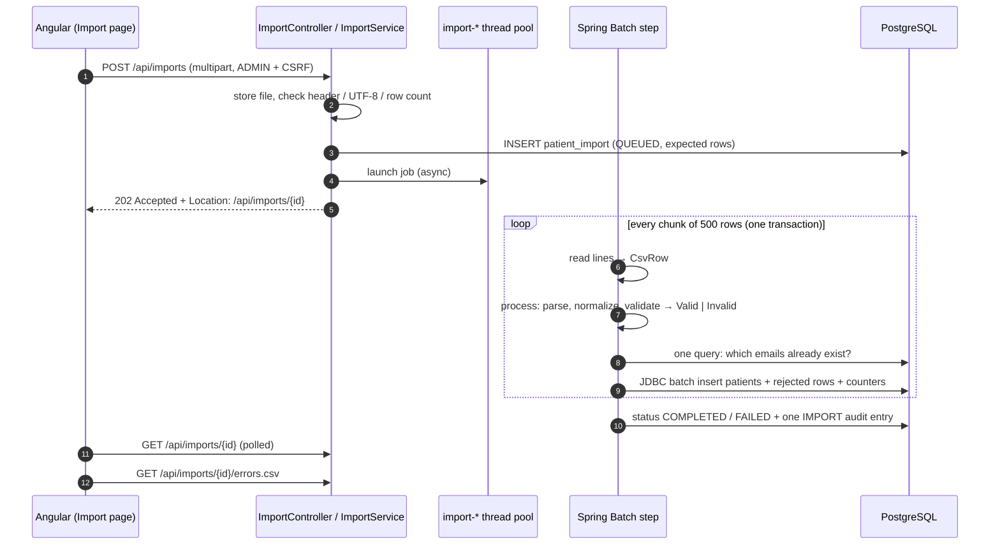

# CSV import pipeline

The import is the showcase feature: upload a messy CSV export, import the good rows, and get a
precise, fixable report of the bad ones. It is a single Spring Batch 5 chunk-oriented step
(`reader → processor → writer`) defined in
[`ImportJobConfig`](../backend/src/main/java/com/medirecords/importjob/ImportJobConfig.java).

## 1. Upload (synchronous, fast)

`POST /api/imports` ([`ImportService.start`](../backend/src/main/java/com/medirecords/importjob/ImportService.java))
does only the checks that deserve an immediate `400` instead of a failed job:

- the file must be a non-empty `.csv`, UTF-8 encoded (a BOM is fine), not binary;
- the header row must contain the required columns (any order, common aliases accepted);
- there must be at least one data row.

It then stores the file in `IMPORT_STORAGE_DIR`, commits a `patient_import` row (`QUEUED`, with the
expected row count for the progress bar), launches the job and returns **202 Accepted** with a
`Location` header. The job runs on its own bounded thread pool (`IMPORT_MAX_CONCURRENT_JOBS`,
default 2, queue of 50). A full queue answers `503` and records the import as failed.

## 2. Reader

A `FlatFileItemReader` streams the file line by line, so memory use is constant whatever the file
size. [`CsvHeader`](../backend/src/main/java/com/medirecords/importjob/CsvHeader.java) maps columns
by normalized name, so `First Name`, `first_name` and `firstname` are the same column:

| Column | Required | Accepted header spellings |
|---|---|---|
| firstName | yes | first name, given name, forename |
| lastName | yes | last name, surname, family name |
| dateOfBirth | yes | date of birth, DOB, birth date, birthday |
| gender | yes | gender, sex |
| email | yes | email, email address, mail |
| city | yes | city, town |
| phone | no | phone, phone number, mobile, telephone, tel |
| bloodType | no | blood type, blood group, blood |

Unknown columns are ignored, which is what lets an error report be fixed and uploaded again (its
extra `row` and `error` columns are skipped). Blank lines are filtered out, `#` is ordinary data,
and lines that cannot even be split into fields (wrong column count, broken quoting) are skipped
through Spring Batch's skip mechanism and recorded with their line number.

## 3. Processor: cleansing and validation

[`ImportRowProcessor`](../backend/src/main/java/com/medirecords/importjob/ImportRowProcessor.java)
turns each row into the **same `PatientRequest` the REST API accepts**, validates it with the
**same Bean Validation rules**, and normalizes it with the **same mapper**. An imported patient
cannot differ from one created in the UI.

| Field | Cleansing |
|---|---|
| all text | trimmed, inner whitespace collapsed, blank → missing |
| email | spaces removed, lower-cased |
| phone | digits and a leading `+` kept; `00` prefix becomes `+` (`(07700) 900-015` → `07700900015`) |
| date of birth | `1980-12-31`, `1980/12/31`, `19801231`, `31/12/1980`, `31.12.1980`, `31-12-1980`, `31 Dec 1980`, `Dec 31, 1980`, and ISO date-times; slash dates are **day first** (UK clinic); strict, so `31/02/1990` is rejected; before 1900 is rejected |
| gender | `F`/`female`/`woman`, `M`/`male`/`man`, `O`/`other`/`X`/`non-binary`, any case |
| blood type | `A+`, `a pos`, `AB negative`, `O-`, `0+` (zero), `A_POSITIVE`, … |

The processor **returns** `Valid` or `Invalid` values instead of throwing. That is the key design
choice: a bad row never triggers a chunk rollback and row-by-row retry, so 250 bad rows in 5,000
cost nothing extra. Every problem in a row is reported together, in column order, for example
`Email 'jane.doe@' must be a well-formed email address; Date of birth '31/02/1990' is not a valid date`.

Duplicate emails **within the file** are caught here (the first occurrence wins, later ones say
`already used on row N`). The processor holds that state per job (`@StepScope`).

## 4. Writer: one transaction per chunk

[`ImportChunkWriter`](../backend/src/main/java/com/medirecords/importjob/ImportChunkWriter.java),
per chunk of `IMPORT_CHUNK_SIZE` rows (default 500):

1. one `SELECT … WHERE lower(email) IN (…)` finds rows that duplicate **existing** patients;
2. one JDBC batch inserts the new patients ([`PatientBulkRepository`](../backend/src/main/java/com/medirecords/patient/PatientBulkRepository.java);
   JPA `saveAll` cannot batch with `IDENTITY` ids);
3. the rejected rows (row number, reason, original line) go to `patient_import_error` and the
   import's counters are updated in the **same transaction**, so the progress the UI polls is
   always exact, never ahead of or behind the data.

A safety net remains: if the database still refuses a row (another request inserted the same email
a moment earlier, caught by the unique index on `lower(email)`), Spring Batch retries that chunk
row by row and only that row is rejected. `processorNonTransactional()` keeps the retry from
re-processing rows and flagging them as duplicates of themselves.

## 5. Finish, audit and failure handling

- The job listener marks the import `COMPLETED` or `FAILED`, deletes the stored file, and writes
  **one** `IMPORT` audit entry with the counts (not 5,000 entries that would bury every other change).
- An import still `QUEUED`/`RUNNING` at start-up was cut off by a restart: it is marked failed
  ("rows imported before this point were kept; upload the file again to import the rest"). A
  re-upload is safe because already-imported rows are rejected as duplicates.

## 6. Results

| Endpoint | Purpose |
|---|---|
| `GET /api/imports` | history, newest first (paged) |
| `GET /api/imports/{id}` | status, counts, progress (the UI polls this) |
| `GET /api/imports/{id}/errors` | rejected rows, paged, by row number |
| `GET /api/imports/{id}/errors.csv` | error report: `row,error,<original columns>`, UTF-8 with BOM for Excel |

The error report keeps each original line untouched, so a user can fix it in a spreadsheet and
upload the same file again.

## Sample data

[`sample-data/patients_messy.csv`](../sample-data/patients_messy.csv) holds 5,000 fictional patients
generated by [`generate_patients_messy.py`](../sample-data/generate_patients_messy.py) (deterministic
seed). It looks like a real export: Excel BOM, CRLF line endings, "friendly" headers (`First Name`,
`DOB`, `Sex`, `Email Address`), stray whitespace, mixed-case emails, many date / phone / gender /
blood-type spellings, quoted fields and blank lines.

Exactly **250 rows (5%) are broken**, one problem each:

| Problem | Rows |
|---|---|
| invalid email | 60 |
| invalid date | 50 |
| missing name | 50 |
| duplicate email within the file | 30 |
| duplicate of a seeded patient | 20 |
| unknown gender | 15 |
| unknown blood type | 10 |
| wrong number of columns | 15 |

On a fresh database the import ends with **4,750 imported and 250 rejected**. Importing it a second
time rejects every row as a duplicate, which is itself a useful demo. Emails use the reserved
`example.*` domains and phone numbers the UK range reserved for drama (07700 900000–900999).
Regenerate with `python sample-data/generate_patients_messy.py`.
